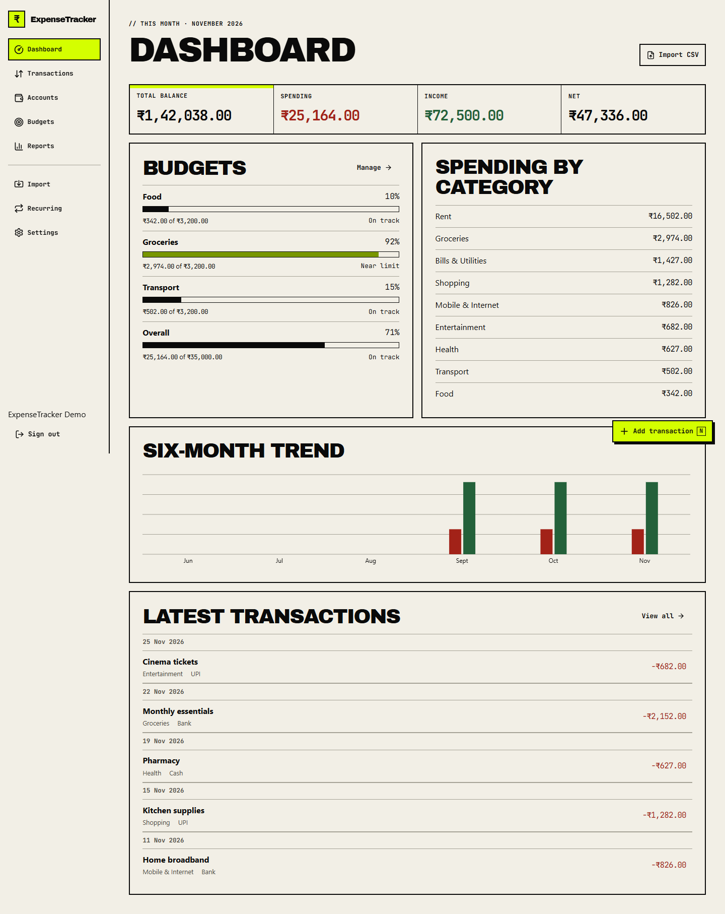

# ExpenseTracker

A personal expense tracker for India. Log expenses and income, keep a running balance for cash, banks, UPI and cards, and move money between your own accounts in the ledger. Set monthly spending limits, review trends, and import or export CSV.



The app stores money as integer paise and displays INR with Indian grouping by default. Transfers are bookkeeping entries. Email and password are sufficient to use the app. Google sign-in appears only when both optional credentials are configured.

## Stack

Next.js 15 App Router, React 19, strict TypeScript, Tailwind CSS 4, Radix Dialog, Lucide, React Hook Form, Zod, Recharts, date-fns, and Papa Parse. Neon Postgres stores the ledger and self-hosted Better Auth records, with Drizzle ORM and migrations.

## Removed old services

| Previous integration           | Replacement                                     |
| ------------------------------ | ----------------------------------------------- |
| Appwrite                       | Neon Postgres and Better Auth                   |
| MongoDB and JWT sessions       | Drizzle ORM and Better Auth sessions            |
| NextAuth and third-party OAuth | Email and password with optional Google sign-in |
| Plaid bank linking             | Manual entry and bank CSV import                |
| Dwolla payments                | Transfers between your own ledger accounts      |
| Sentry                         | Error boundary and server logs                  |

## Local setup

Use Node.js 22.12 or later. Install and authenticate the Neon CLI, then link the project you want to use.

```sh
npm install -g neon@latest
neon login
neon init -y --org-id YOUR_ORG_ID --project-id YOUR_PROJECT_ID --branch production --services postgres --package-manager npm
neon deploy
npm install
```

Keep the pooled and direct database URLs in `.env.local`. Generate a secret with `openssl rand -base64 32` and set `BETTER_AUTH_SECRET` and `BETTER_AUTH_URL=http://localhost:3000`. See [the environment template](.env.example).

```sh
npm run db:migrate
npm run db:seed
npm run dev
```

Open [localhost:3000](http://localhost:3000). Seeding adds `demo@expense.local` with password `demo1234` and three months of sample data. Run the seed only when you intend to enable that demo login.

Set up a separate Neon test branch before integration or browser checks. Store its pooled URL, direct URL, separate auth secret, and local auth origin in `.env.test`. Use an unused port, such as `http://127.0.0.1:3317`.

```sh
neon checkout test --create --no-env-pull
neon env pull --branch test --file .env.test -e DATABASE_URL -e DATABASE_URL_UNPOOLED
neon checkout production --no-env-pull
npm run db:test:migrate
npm run lint
npm run typecheck
npm test
npm run build
npm run test:e2e
```

The browser suite starts the built app through `npm start` and requires Chrome. The database isolation check runs when `.env.test` is present. Repository CI secrets used for integration checks must point to the test branch.

## Import a bank statement

Choose **Import bank CSV**, select the bank preset and destination account, then upload your CSV. Preview the rows before confirming. The importer flags existing entries using date, signed amount and normalized description. For an unfamiliar layout, choose **Generic CSV** and map the date, description, and amount columns.

- **SBI.** In OnlineSBI open **My Accounts & Profile → Account Statement**, choose the account and dates, then download the spreadsheet. [SBI statement guide](https://sbi.bank.in/documents/21077/35799534/02022026_SBI%2B-%2BGlobal%2BConnect_NRI%2BJanuary_final%2Bversion.pdf/d36001c3-b719-6a24-2db1-c37b2dc6f4f5?t=1770024717525)
- **HDFC Bank.** In NetBanking open **Account Statements → Get Statement**, choose the account and date range, then download the available spreadsheet export. [HDFC statement guide](https://www.hdfc.bank.in/blogs/digital-banking/download-account-statement-via-netbanking)
- **ICICI Bank.** In Net Banking open **Bank Accounts → e-Statements → View Detailed Statement**, select the date range and download CSV or Excel. [ICICI statement guide](https://www.icici.bank.in/personal-banking/accounts/savings-account/statements) · [Supported formats](https://www.icici.bank.in/personal-banking/ways-to-bank/net-banking/online-services)

If the portal gives you an Excel workbook, open the transaction sheet in a spreadsheet app and save it as UTF-8 CSV. Keep the header row and debit and credit columns. PDF files need to be converted before import. Axis and Kotak presets are also available.

## Deploy to Vercel Hobby

Import the repository as a Next.js project, choose Node 22 or later, and set these variables in the Vercel project. Set the production variables to the production branch and keep test credentials in the test environment.

| Variable                | Value                                     |
| ----------------------- | ----------------------------------------- |
| `DATABASE_URL`          | Pooled Neon connection URL                |
| `DATABASE_URL_UNPOOLED` | Direct Neon connection URL for migrations |
| `BETTER_AUTH_SECRET`    | Random secret of at least 32 characters   |
| `BETTER_AUTH_URL`       | Full HTTPS URL of the application         |
| `GOOGLE_CLIENT_ID`      | Optional Google OAuth client ID           |
| `GOOGLE_CLIENT_SECRET`  | Optional Google OAuth secret              |

Run `npm run db:migrate` against the direct URL before serving production traffic. After deploying, check `GET /api/health`.

## Automatic capture configuration

| Variable           | Purpose                                                                    |
| ------------------ | -------------------------------------------------------------------------- |
| `GROQ_API_KEY`     | Optional server-side key for AI parsing. Without it, AI parsing is off.    |
| `GROQ_MODEL`       | Alert model. Defaults to `openai/gpt-oss-20b`.                             |
| `GROQ_MODEL_LARGE` | Statement and CAS model. Defaults to `openai/gpt-oss-120b`.                |
| `CRON_SECRET`      | Optional bearer secret for scheduled jobs, at least 32 characters.         |
| `ENCRYPTION_KEY`   | Optional 32-byte base64 key for encrypting saved mail and PDF credentials. |

Generate the cron secret and encryption key independently, for example by running `openssl rand -base64 32` twice. Keep production and test databases separate. Store capture secrets in the hosting environment or in ignored local environment files.

Groq models were chosen from `GET https://api.groq.com/openai/v1/models` on 2026-11-25: `openai/gpt-oss-20b` (fast, JSON output) for alerts and `openai/gpt-oss-120b` for statement and CAS pages.

## Automatic capture

Every source goes through one pipeline in `lib/capture/`: parse, mask, categorize, dedupe, insert in one database transaction, and record an import job. Regex templates handle SBI, HDFC, ICICI, Axis, Kotak, Google Pay, PhonePe and Paytm alerts with confidence 95. Unknown formats from bank senders go to Groq when `GROQ_API_KEY` is set, capped at confidence 70, so they always land in **Review**. OTPs, promotions, reminders, failed payments and balance-only alerts are ignored.

Masking runs before anything reaches Groq or the database. Account and card numbers become their last four digits; PAN, Aadhaar-like numbers, phone numbers, emails and one-time codes are removed. Raw SMS, email bodies and PDFs are parsed in memory and never stored. Payment references labelled `Ref`, `UTR`, `RRN` or `UPI/…` are kept because dedupe needs them.

The same payment arriving by SMS, email, PDF and CSV is stored once: a matching reference is a duplicate; otherwise last four digits, amount, type, date ±1 day and a similar merchant must all match.

### SMS

- **Paste SMS**: press `N`, choose **Paste SMS**, preview and save.
- **Webhook**: create a token in **Settings → Ingest tokens & devices**, then `POST /api/ingest/sms` with `Authorization: Bearer <token>`. It accepts `{"text","sender","receivedAt"}`, `{"messages":[…]}` (up to 100), the default JSON of [Incoming SMS to URL forwarder](https://github.com/bogkonstantin/android_income_sms_gateway_webhook) and SMS events from [Message487](https://github.com/andre487/AndroidMessage487). The limit is 60 requests a minute per token.

```sh
curl -X POST "$APP_URL/api/ingest/sms" -H "Authorization: Bearer $TOKEN" -H "content-type: application/json" \
  -d '{"sender":"AD-SBIUPI","text":"Dear UPI user A/C X1234 debited by 250.00 on date 25Nov26 trf to SWIGGY Refno 433012345678. -SBI"}'
```

Message487 sends the Bearer token itself; turn off its n8n confirmation or keep it, since the endpoint replies with `{"status":"accepted","event_id":…}`. The forwarder app's custom-header setting is not documented in its README, so confirm it can send the `Authorization` header before relying on it.

**iPhone Shortcuts**: create a personal automation for **Message** where the message contains `debited`, then add a second one for `credited`. Add **Get Contents of URL** with method `POST`, URL `…/api/ingest/sms`, header `Authorization: Bearer <token>`, and a JSON body with `text` set to _Shortcut Input → Message_, `sender` set to _Sender_. Turn off **Ask Before Running**.

### Email

**Settings → Connect email** takes an IMAP host, port, user and app password (Gmail: `imap.gmail.com`, port 993, with an [app password](https://support.google.com/accounts/answer/185833)). The login is tested read-only before saving, and the password is encrypted with AES-256-GCM using `ENCRYPTION_KEY`. Only the listed bank sender addresses are searched, only after the last processed UID, in batches that save progress. PDF attachments go through the statement and CAS importers using an optional saved, encrypted PDF password; without one the job is marked **Needs password**.

`.github/workflows/sync.yml` calls `POST /api/cron/email-sync` every 15 minutes and `GET /api/cron/nav` daily, using the `CRON_SECRET` repository secret and the `PROD_URL` repository variable. GitHub can delay or skip scheduled runs, so captures may lag; **Sync now** runs the same sync on demand.

### PDF statements and CAS

**Import → PDF statement** reads SBI, HDFC, ICICI, Axis and Kotak statements by rebuilding rows from text positions. The password, if any, is used once and never stored. A statement imports only when opening + credits − debits equals closing within ₹1. Unknown layouts go to Groq page by page when it is configured. The parser accepts up to 10 MB and 200 pages, but Vercel caps request bodies at 4.5 MB, so larger files must be imported from a local or self-hosted server.

**Import → CAS (investments)** reads CAMS and KFintech mutual fund statements and NSDL or CDSL e-CAS holdings. Units are checked against transactions per folio (±0.001); mismatches are marked for review. PAN, names, addresses and emails are never stored. AMFI's `NAVAll.txt` updates NAVs for held schemes daily and fills scheme codes from ISINs. The parser is original TypeScript; the open-source [casparser](https://github.com/codereverser/casparser) project (MIT) was used as a reference for the CAS layouts.

Synthetic test PDFs are generated with `npm run fixtures:pdf`. `npm run test:groq` runs one live Groq call against the Neon test branch and is skipped without a key.

### Mobile JSON API

`/api/v1/*` uses the Better Auth session (cookies, or the Expo client's cookie header) and returns errors as `{"error":{"code","message"}}`. Routes: `GET dashboard`; `GET, POST transactions` with cursor pagination; `GET, PATCH, DELETE transactions/:id` and `POST transactions/:id/restore` within a five-minute undo window; `GET categories`, `accounts`, `budgets`; `GET review` and `POST review/:id` with `approve`, `reject` or `edit`; `GET devices`, `DELETE devices/:id`, `POST devices/register`; `GET sms/senders`.

## Android

The Android app uses your existing ExpenseTracker account and can capture masked bank SMS in the background. See the [Android build, signing and emulator instructions](mobile/README.md) and the [SMS privacy disclosure](https://expense-tracker-stmh.vercel.app/privacy). Reports, imports, investments and budget editing are available on the web.

For a future Google Play release, create a Play Developer account, submit an Android App Bundle and complete the Play Console SMS Permissions Declaration for SMS-based money management. Include a demo video that shows the in-app disclosure, permission grant, masked SMS capture and how to turn access off. Publish the privacy policy and complete Data safety disclosures before submission. The current release path uses GitHub Releases.

## Roadmap

- Password reset through a free email provider
- PWA and offline entry

See [verification results](docs/verification.md), [Contributing](CONTRIBUTING.md), and the [Code of Conduct](Code_of_conduct.md).
